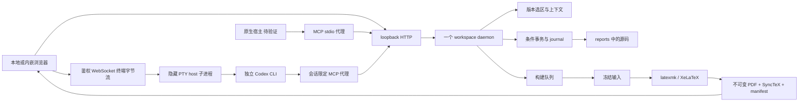

# 工作台架构与边界

完整设计见 plan.md，当前验证见 acceptance.md。

## 数据流

application 是组合根，业务接口在 shared/contracts.ts 和 ports.ts。stdio 不持有独立选区/文件锁/队列。owner.lock、service.json 和健康身份保证同一工作区只有一个服务；stdio 每次调用重新发现，服务闲置退出后可重新拉起。

网页终端由 daemon 拥有，CLI 的只读 shell 与事务 MCP 写入分开。会话权限绑定 report/view/context/selection；暂停、换绑、断线与结束使 revision 失效，授权检查随内部调用进入事务锁并在落盘/提交前重检。Web Locks 区分刷新和复制标签页。VT 回放期间抑制终端设备应答，避免旧握手回复进入输入框；实时查询仍正常响应。原生 PTY 放在独立隐藏进程，退出回收 ConPTY 线程与句柄。

## 存储与事务

报告级 .latex-report.json 是注册依据，workspaceId/reportId 为持久 UUID。reportRevision 组合输入文件原始字节和配置语义；fileVersion 是原始字节 SHA-256，源码偏移为 LF 规范化文本的 UTF-16。

同一报告写锁 → 校验 context/selection/expectedVersion → 备份 before/after 并写 prepared journal → 替换前再次校验 → 同目录临时文件原子替换 → committed 历史 → context 移动/事件/入队。失败和撤销中途失败即时走恢复；外部新内容不会被自动覆盖。新文件撤销会删除新文件。删除的版本标记为 afterVersions 中的空字符串，当前未提供完整 redo 操作。

watcher debounce 发布变更并构建。UI 事件读返回时再次检查报告、路径、版本、文本及 dirty，避免刷新覆盖草稿；报告/文件切换的过期响应不会应用。

## 编译与 PDF

构建最多并发一个，运行中新的 revision 标 dirty，结束后编译最后保存版本。快照重核 revision，复制期间变化重试。禁用 shell escape，进程参数数组、不弹终端，设置超时与终止。TeX 限制不是 OS 级沙箱。

成功 PDF、SyncTeX 和 manifest 与 buildId 成对且不可变；失败保持 currentSuccessfulBuildId。PDF.js 使用同版本内联 worker、canvas+DPR、文本层和页面虚拟化。页面与显示 build 身份核对后才允许定位；加载中/失败不得将旧页坐标交给新构建。

SyncTeX 单位为未旋转页面左上角 big point。Windows stdout UTF-8 失败时按 GB18030 解码；正查用 h/v 基线，不按冒号切路径。几何转换覆盖缩放、DPR、旋转和显式 cropOffset 单元 fixture；实际非零裁剪原点页禁用点击，完整特殊页面矩阵未验证。

原位编辑：实际显示 build → 服务端唯一定位 → live version/锚点 → editable/protected runs → 仅提交 runId/纯文字 → LaTeX 转义 → 同一事务 → 成功重编译移除叠层。多候选、未知宏、数学/宏参数内部行拒绝猜测。未保存草稿在当前标签页存储，不进入正式导出。

## 本地与宿主边界

HTTP 只监听 127.0.0.1，检查 Host、Origin、Bearer、JSON、协议和请求限额。运行凭证目录使用 Windows 当前用户 SID ACL，静态服务只暴露 UI。MCP PDF 字节放 _meta['latex/assetChunk']，不进入 model-visible content。

包内服务器依赖、UI/worker、模板自包含；报告根目录显式传入，不由缓存 cwd 推断。本机 Node 路径固定，换机器须重新配置。真实缓存 stdio 测试不证明原生 root 环境注入或 MCP Apps handshake。

原生 SDK 适配包含 updateModelContext 和显式消息能力检查；未握手不声称支持。当前图像返回 attached:false。清理是显式 dryRun/执行端口，尚未自动调度；增量缓存、懒加载、20 页/32 MiB 性能与完整引擎矩阵待补。

## HTML 日常编辑（2026-10-25）

mainFile 为 .html 时，保存/patch/undo/watcher 只发文件事件，不向构建队列入队。React 使用共享 parse5 投影和 KaTeX MathML 显示原稿；源码草稿直接在本页投影，磁盘事件按 300 ms 间隔轮询。既有 LaTeX 报告继续自动编译。

预览位于 sandbox=allow-scripts 的 iframe。原稿脚本、事件、表单、远程资源被移除；只添加工作台自己的静态 html-preview.js。父页面 CSP 保持严格，不为内联脚本放宽；父子消息校验 iframe window 和当前文档 key。HTML/CSS/SVG 投影与 LaTeX 导出是两个投影：导出保留语义结构，不能将任意 CSS 精确复制到 TeX。

块标识由源码位置派生，只是版本内查询键。html_select / html_edit 重新读取原稿，校验 context/report/view 和原始 SHA-256，在服务端查找块并确定 UTF-16 LF 范围。普通改字只允许纯文本子节点，替换 HTML 实体转义后进入原有 journal 事务；公式、嵌套格式和注释块不能普通覆盖。幂等重试复用 operationId。

显式 HTML PDF / LaTeX 包导出才冻结输入，运行 Pandoc 生成 generated-report.tex，再由既有 latexmk/XeLaTeX 队列编译。生成文件不写回报告目录。成功后核对当前 revision；中途改稿则拒绝导出过期稿。原生 MCP 宿主中的 HTML iframe 静态脚本加载仍待真实验收。
